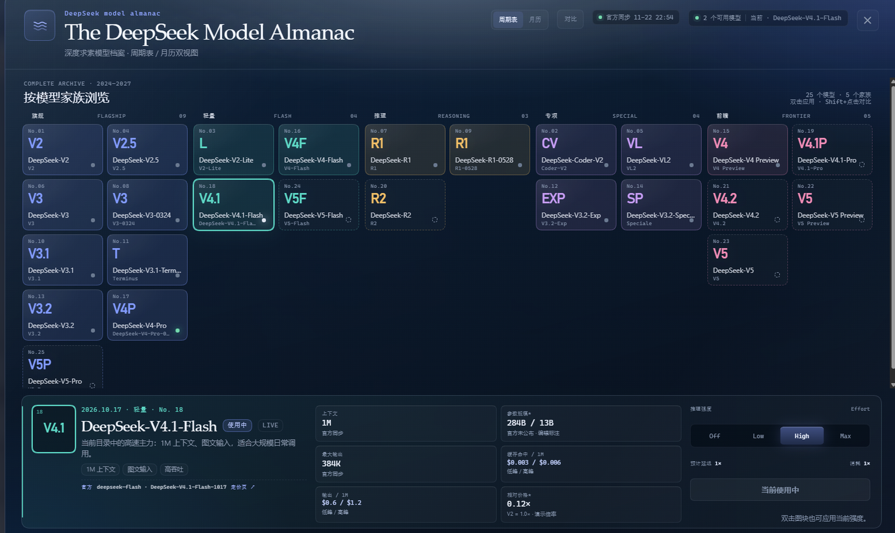
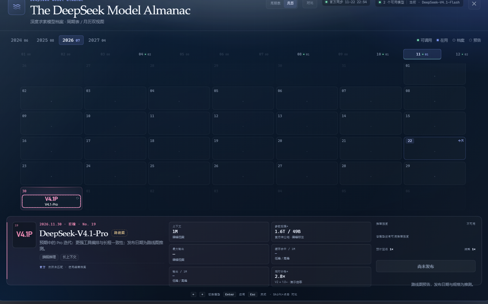
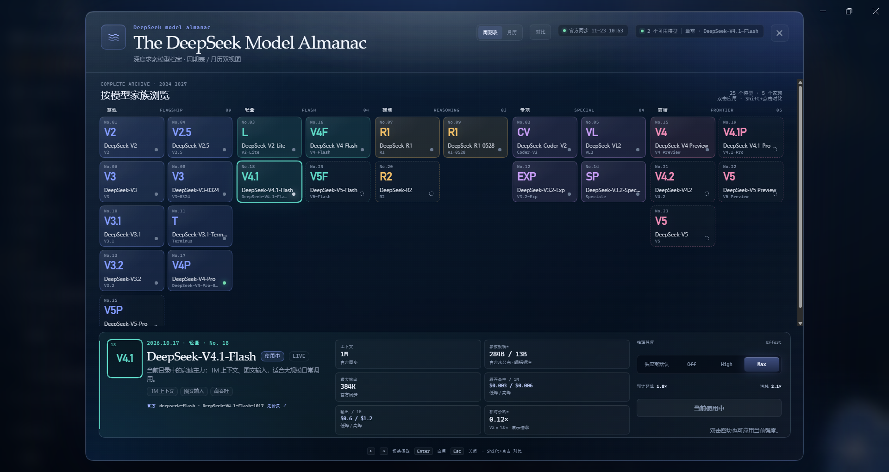
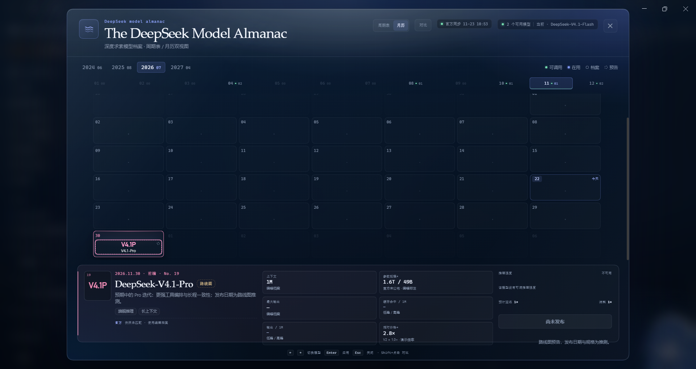
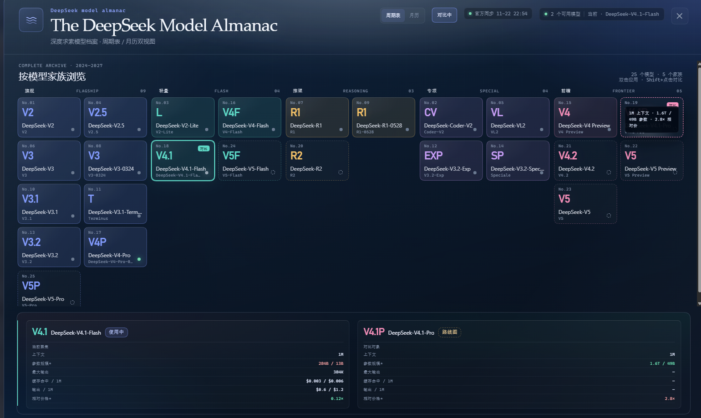
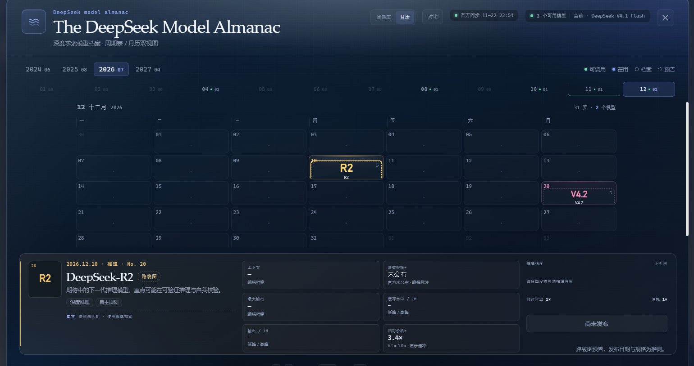

# The DeepSeek Model Almanac

一个面向 DeepSeek Harness（DSH）的 DeepSeek 模型档案插件。长按或右键输入框里的官方模型胶囊，就能打开按模型家族排列的周期表、31 天发布月历、Bento 详情和双模型对比。

模型档案使用 DSH 当前可用的模型目录作为调用来源，并从 DeepSeek 官方定价文档同步版本、上下文、最大输出、能力与价格。历史模型只用于浏览，路线图模型会明确标记为预测，不会伪装成可调用模型。

<p align="center">
  
</p>

## 功能

- **两种浏览方式**：默认周期表按旗舰、轻量、推理、专项、前瞻五个家族排列；月历按 31 天展示发布日期。
- **官方入口绑定**：只接管 DSH composer 里的官方模型座位，短按仍打开原生模型菜单。
- **长按与鼠标操作**：长按 500ms 或右键打开档案；方向键、Enter、Esc 支持键盘浏览和应用。
- **Bento 详情**：集中展示版本、发布日期、上下文、最大输出、参数标注、能力和价格。
- **模型对比**：开启「对比」后 `Shift + 点击` 第二个模型，底部切换为双栏 Diff。
- **推理强度切换**：直接复用当前模型目录提供的 `reasoning.efforts`。
- **官方数据同步**：宿主每 6 小时拉取一次 DeepSeek 官方定价 Markdown，使用 ETag / Last-Modified 条件请求并按 last-known-good 策略缓存。
- **响应式布局**：窄屏使用年份、家族筛选与纵向列表；680px 及以下切换为全屏面板。
- **无需 API Key**：只读取公开文档，不调用模型，不接触账户额度。

## 界面预览

### 周期表

完整档案按家族组织，当前可调用模型、历史档案和预测模型使用不同状态呈现。


### 月历

月历保留 31 格日期结构。没有发布记录的月份会被禁用，已有记录会显示对应模型与状态。



### 桌面全窗

在完整桌面窗口中查看周期表与详情区：





### 对比模式

选择一个模型作为基准，再 `Shift + 点击` 第二个模型，即可比较上下文、参数、价格与能力差异。



### 路线图与预告

2026Q4 至 2027 的预测型号使用虚线幽灵图块。它们只作概念展示，不是 DeepSeek 官方路线图，也不能调用。



## 安装

### 从 GitHub 安装

```sh
dsh plugin add https://github.com/kleinklein0824/dsh-deepseek-atlas
```

安装后请完全退出并重新打开 DSH。DSH 会在应用进程启动时读取插件清单；首次安装或升级宿主侧代码后，单纯刷新页面不会重新加载 `index.js` 与 `lib/official.js`。

### 从本地目录安装

```sh
git clone https://github.com/kleinklein0824/dsh-deepseek-atlas.git
dsh plugin add ./dsh-deepseek-atlas
```

本项目没有构建步骤，也没有运行时 npm 依赖。修改 `client.js` 后可刷新页面热验证；修改宿主侧文件后需要重启 DSH。

## 使用方法

| 操作 | 结果 |
| --- | --- |
| 短按 / 左键点击模型胶囊 | 打开 DSH 原生模型菜单，本插件不接管 |
| 长按模型胶囊 500ms | 显示进度描边，然后打开模型档案 |
| 右键模型胶囊 | 打开模型档案 |
| 顶部「周期表 / 月历」 | 切换两种档案视图 |
| 单击周期表方块 | 聚焦并显示详情 |
| 双击周期表方块 | 直接应用该模型 |
| `←` / `→` | 跳到上一个 / 下一个有效模型 |
| `Enter` | 应用当前聚焦的模型 |
| `Esc` | 关闭档案或取消聚焦 |
| `Shift + 点击` | 在对比模式下选择第二个模型 |
| 点击年份 / 月份胶囊 | 切换年份与月份；没有记录的月份禁用 |
| 点击背景 | 关闭档案 |

长按打开档案后会吞掉那次合成点击，因此官方模型菜单不会同时弹出。周期表方块使用 `:focus-visible` 区分键盘焦点与鼠标点击，避免 `Shift + 点击` 时先覆盖当前模型。

## 官方数据同步

档案中的官方字段来自：

<https://api-docs.deepseek.com/quick_start/pricing.md>

同步流程：

1. 宿主每 6 小时发起一次公开 Markdown 请求，并携带 `ETag` / `Last-Modified` 条件请求头。
2. 官方返回 `304 Not Modified` 时复用当前快照。
3. 解析成功后使用临时文件加 rename 的方式原子写入 `official.json`。
4. 网络、解析或写入失败时保留上一次成功快照，并标记为 stale。
5. 客户端打开档案后读取宿主快照，之后每 10 分钟轮询；失败时按 15s、30s、60s 逐步退避到 300s。

宿主路由：

| 方法 | 路径 | 用途 |
| --- | --- | --- |
| `GET` | `/dsh-deepseek-atlas/official.json` | 读取当前快照 |
| `POST` | `/dsh-deepseek-atlas/refresh` | 手动刷新，带 15 秒冷却 |

缓存文件默认位于：

```text
$DSH_HOME/deepseek-atlas/official.json
```

未设置 `DSH_HOME` 时使用 `~/.dsh/deepseek-atlas/official.json`。缓存不写进依赖目录。

### 同步字段

| 字段 | 是否同步 | 说明 |
| --- | --- | --- |
| 模型 id / 版本号 | 是 | 来自官方定价表 |
| 上下文窗口 / 最大输出 | 是 | 来自 `CONTEXT LENGTH` / `MAX OUTPUT` |
| 思考模式、FIM、Vision | 是 | 按官方能力行解析 |
| JSON / Tools / Responses / Anthropic / Prefix | 是 | 详情中显示为能力标签 |
| 缓存命中 / 未命中 / 输出单价 | 是 | 区分 off-peak / peak |
| 并发上限 | 是 | 来自 `CONCURRENCY LIMIT` |
| OpenAI / Anthropic base URL | 是 | 来自官方表 |
| 总参数 / 激活参数 | 否 | 官方定价页不公布，编辑值带 `*` 标注 |
| 发布日期 | 部分 | 官方定价页没有发布日期，历史记录使用人工核对值；新 id 可能带 `inferredDate` |
| 相对价格 | 否 | 以 V2 为 1.0x 的编辑演示倍率，不是官方定价 |

## 数据语义

- **当前 / 可用**：只以运行时 `modelDirectories` 为准确认可调用模型。
- **历史档案**：2024–2025 的 V2、V3、R1 系列仅展示，不可调用。
- **路线图**：2026Q4–2027 的预测型号使用虚线幽灵图块，仅作概念展示。
- **能力标签**：部分标签是编辑标注，官方能力以详情中的「官方」行为准。
- **相对价格**：以 V2 为 1.0x，用于直观比较，不代表官方账单。
- **匹配策略**：显式映射 → `apiIds` 精确匹配 → 官方版本号前缀；不使用会误匹配退役模型的模糊别名。

## 设计边界

- 不替换 `conversation.input.model`，原生模型菜单、标签和选项子槽保持原样。
- 桥接项注册在 `conversation.input.right`，只渲染隐藏所有权标记，不占视觉空间。
- 档案注册在 `shell.overlay`，内容 portal 到 body，使用顶层 `z-index`。
- 不依赖哈希 CSS 类名；候选触发器必须同时满足官方按钮、模型 id、composer 卡片和 bridge 所有权条件。
- 官方文档不是稳定 API，解析器采用「宁可 stale，也不写坏数据」的策略。

## 项目结构

```text
dsh-deepseek-atlas/
├─ package.json          # dsh.bundle manifest 与 package metadata
├─ cordis.patch.yml      # DSH 插件注册补丁
├─ index.js              # 宿主侧路由、刷新冷却与同步生命周期
├─ lib/official.js       # Markdown 解析、条件请求、原子缓存
├─ client.js             # 入口绑定、周期表、月历、Bento、对比与样式
├─ screenshots.json      # dsh-market 截图声明
└─ docs/                 # README 与市场截图
```

## 开发检查

项目没有构建步骤。提交前至少执行：

```sh
node --check index.js
node --check lib/official.js
node --check client.js
```

然后重启 DSH，验证长按、右键、周期表、月历、对比、键盘导航和官方刷新状态。

## 隐私与网络

- 不包含 API Key，不需要账户凭据。
- 不读取或上传对话内容。
- 唯一的外部请求是公开的 DeepSeek 官方定价 Markdown 页面。
- 缓存只写入本地 DSH 数据目录。

## 许可证

[MIT](LICENSE)
